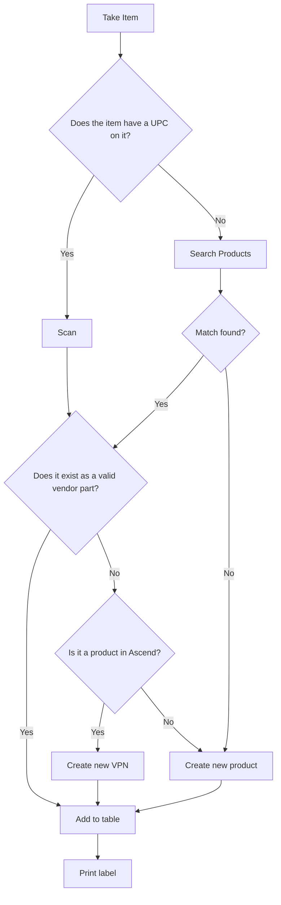

# Receiving Flow

## Receiving Workflow

### Overview

**High Level Goal:** Permit multiple users to simultaneously collect information for, tag, and check-in items for large receiving orders.

**Order Receipt Components**: An order receipt's central part is its *order items* — the product quantities we are receiving into inventory. Each order item is either a **Vendor Product** (Ascend already carries the vendor's part number) or a **New Product** (a record staged in Bullwheel because Ascend does not carry that vendor part number yet), chosen by the item's *Item Type*.

**Bullwheel never writes to Ascend.** Ascend validates products and vendor products when they are created in Ascend, and Bullwheel cannot replicate that validation. Items that Ascend does not have are staged as **New Product** records in Bullwheel and exported on an Ascend *Vendor Products* import sheet, which staff import into Ascend.

### Implementation

**Frappe Workflows:** Before any custom coded controllers are handlers are made, the viability of Frappe Framework's built-in Workflows feature should be evaluated first. 

**Current Setup:** The Doctype Order Receipt, under the Ascend module, has fields for the Vendor, Purchase Order Number, and an Order Items table (child Doctype Order Receipt Item, whose `vpn` is a Dynamic Link to a Vendor Product or a New Product). The standalone New Product Doctype is the entry UI for both cases below. Order Receipt Receiving is a Frappe Workflow (Submitted → Arrived → Received); completing receiving is refused while a New Product on the order has not been exported yet.

## New Product lifecycle

A New Product is a record that lives in Bullwheel until Ascend has it:

| Status | Meaning |
|---|---|
| Pending | Saved, not on any export yet. Editable. |
| Exported | On an import sheet. Locked (identity and cost fields) so it still matches what Ascend received. *Revert to Pending* unlocks it. |
| Imported | Ascend created it and Bullwheel matched it (see *Matching* below). It now links to its Ascend Product. |
| Import Failed | Ascend rejected the row. *Re-queue for Export* sends it back to Pending. |
| Cancelled | Not going to Ascend. Cannot be deleted while it is Exported, or while an order, bay or swap batch refers to it. |

There are two kinds, chosen by *Entry Type*:

- **New Product (Case A):** the product is not in Ascend. The full form (category, brand, model, MSRP, cost, description template, pricing rule, ski details, …). The Store SKU is assigned by Ascend, so it is blank until matching.
- **Existing Product (Case B):** the product is already in Ascend — or is a pending New Product of *another* vendor — but this vendor has no part number for it. The simplified form asks only for the vendor part number and cost; everything else is copied from the product. Ascend attaches the part number to the existing product **by UPC**, so a product with no UPC cannot be handled this way (add the Vendor Product in Ascend directly).

Until the product is imported, a New Product can be received on an order, printed (Ascend Tag, Swap Tag, Online Tag — the barcode is the UPC, falling back to the VPN), added to a Swap Tag Batch, and checked into a Warehouse Location, exactly like an Ascend Product.

## Exporting and importing

*Export Received Batch* (Order Receipt) downloads, for the order's unreceived items, a PO sheet and — when the order has Pending New Products — a Vendor Products sheet, zipped together. Products that cannot be imported yet are left unreceived and listed in the zip. *Bulk Product Import* exports a vendor's Pending New Products that are not on an order.

1. In Ascend: **File → Import → Vendor Products**. Choose the order's vendor in Ascend's import dialog — the sheet does not name it, so a sheet holds one vendor's products. Import the *Vendor Products* sheet **first**.
2. Create the Ascend order and **File → Import from Excel** the *PO* sheet (its identifiers are the VPNs just imported).

## Matching

A scheduled job (every 15 minutes) and the *Check Ascend* buttons look for the Vendor Product Ascend now holds as `<VPN> (<vendor>)` for each Pending/Exported New Product. For each match Bullwheel marks the New Product Imported, records the Store SKU Ascend assigned, creates the Product Price records (swap/online prices) and the Ski with Bindings record for it, and repoints warehouse bay rows and swap tag batch rows from the New Product to the Ascend Product. Labels printed afterwards come from the live Ascend Product.

`bench --site <site> audit-bullwheel-products` lists the Ascend products Bullwheel created directly before this change and what is missing on them.

## Vendor Product Scanning and Validation

The following is a high-level overview of how vendor product scanning and checking works. The primary goal of the flow is to avoid circumstances were we are re-entering information for a product that already exists in Ascend.

For example, if we receive a new Dalbello boot as part of a buyout, instead of manually entering the boots information (description, brand, style, color, size, etc.) to create the new Vendor Product, we lookup to see if we have received that same Dalbello boot under a different vendor, and reuse that product information.

### Mermaid Diagram



---

### Structured Text Description

**Start:** Take Item

1. **Decision — Does the item have a UPC on it?**
   - **Yes** → Go to step 2a (Scan)
   - **No** → Go to step 2b (Search Products)

2. **Path A — Item has UPC:**
   - **Scan** the item
   - Go to step 3 (valid vendor part check)

   **Path B — Item has no UPC:**
   - **Search Products** manually
   - **Decision — Match found?**
     - **Yes** → Go to step 3 (valid vendor part check)
     - **No** → Go to step 5 (Create new product)

3. **Decision — Does it exist as a valid vendor part?**
   - **Yes** → Go to step 6 (Add to table)
   - **No** → Go to step 4 (Ascend check)

4. **Decision — Is it a product in Ascend?**
   - **Yes** → **Create new VPN** → Go to step 6 (Add to table)
   - **No** → Go to step 5 (Create new product)

5. **Create new product** → Go to step 6 (Add to table)

6. **Add to table**

7. **End: Print label**

---

### Node Summary

| Node | Type | Description |
|------|------|-------------|
| Take Item | Start | Entry point; pick up a physical item to receive |
| Does the item have a UPC on it? | Decision | Check for barcode/UPC label on the item |
| Scan | Process | Scan the item's UPC barcode |
| Search Products | Process | Manually search for the product in the system |
| Match found? | Decision | Did the manual search return a matching product? |
| Does it exist as a valid vendor part? | Decision | Check if the scanned/matched item is a known vendor part |
| Is it a product in Ascend? | Decision | Check if the product exists in the Ascend RMS database |
| Create new VPN | Process | Stage an Existing Product entry carrying the new Vendor Part Number (exported on the import sheet) |
| Create new product | Process | Stage a New Product in Bullwheel (exported to Ascend on an import sheet) |
| Add to table | Process | Add the item (via any path) to the receiving table |
| Print label | End | Print a label for the received item |

### scan_item() Static Method
```
bullwheel.ascend.doctype.order_receipt.order_receipt.scan_item
```

scan_item() is a whitelisted, static method that handles the New Product, Vendor Product and Product existance checks. The method is currently called inside order_receipt.js when the user enters a barcode value into a designed scanning field. It takes two paramters: *id* and *vendor*. The id parameter is the value scanned by the user. It could be a UPC, Ascend SKU, VPN, etc. The vendor parameter is the exact name of the vendor as it appears in Ascend.

It checks, in order: a New Product already staged for this vendor (so the second unit of a pending product adds to the same record), a Vendor Product in Ascend for this vendor, any Product in Ascend, then a New Product staged for *another* vendor.

**Return Values** scan_item() returns a tuple with two elements. The first is a status string, as detailed below. The second is a record describing what was found.

|Status|Record|
|------|---------|
|'new product found'| A New Product staged for this vendor. The record's `name` is added to the order. |
|'vpn found'| A Vendor Product was found. Returns its name (`<VPN> (<vendor>)`), cost, description and UPC. |
|'product found'| No Vendor Product was found, but an Ascend Product was. Returns its Store SKU, UPC and details; the user is asked for a vendor part number and cost, which stages an Existing Product. |
|'pending product found'| Not in Ascend, but staged as another vendor's New Product. Same prompt as 'product found', staging an Existing Product that refers to the pending New Product. |
|'not found'| Nothing matches. Returns NoneType. The user may create a New Product. |
